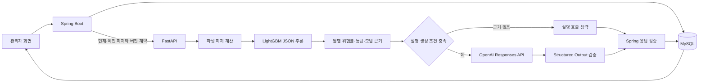

# 미리봄: 신용카드 연체 위험 조기예측

미리봄은 금융회사 관리자(BO)가 고객의 월별 카드 이용 변화를 살펴보고, 향후 1·2·3개월의 연체 위험을 확인할 수 있도록 만든 금융 AI 공모전 팀 프로젝트입니다.

LightGBM 모델이 위험률과 등급을 계산하고, LLM은 그 결과와 검증된 지표를 담당자가 읽기 쉬운 설명으로 정리합니다. LLM이 위험률을 다시 계산하거나 LightGBM의 등급을 바꾸지는 않습니다.

## 주요 기능

- 대시보드에서 분석 대상, 고위험 고객, 위험도 상승 고객, 분석 완료율과 위험 분포 확인
- 고객 목록 검색 및 고객별 카드 이용·청구·신용·잔액 조회
- 고객별 최신 피처 스냅샷을 이용한 1·2·3개월 연체 위험 추론
- 모델 근거와 전월 대비 변화에 기반한 구조화 LLM 설명 생성
- 동일한 피처 스냅샷과 모델 결과 재사용 및 프롬프트 버전 변경 시 설명 재생성
- 전체·고객별 예측 이력 조회
- 최대 50명의 고객을 대상으로 하는 관리자 다건 분석과 실패 항목 재시도
- 모델·피처·프롬프트 버전, 응답 필드와 LLM 참조 무결성 검증

## 팀 프로젝트와 담당 범위

이 저장소는 공모전 팀 프로젝트에서 개발한 결과물의 포트폴리오용 사본입니다.

| 구분 | 담당 범위 |
| --- | --- |
| 마지우 | Spring Boot 백엔드, 관리자 화면, FastAPI 추론 서버, 제공된 모델 연동, LLM 설명 연동과 검증 |
| 모델 담당 팀원 | 모델 학습과 최종 모델 산출물 제공 |

모델 학습은 모델 담당 팀원이 수행했습니다. 이 저장소의 FastAPI 코드는 전달받은 LightGBM JSON 산출물을 로딩하고, 계약을 검증한 뒤 추론에 사용합니다.

## 기술 구성

| 영역 | 기술 |
| --- | --- |
| 관리자 웹·API | Java 17, Spring Boot 3.3.3, JSP, JavaScript |
| 데이터 접근 | MyBatis 3.0.3, MySQL |
| AI 서버 | Python 3.11, FastAPI, Pydantic |
| 모델 추론 | 제공된 LightGBM JSON 트리 산출물을 직접 파싱하는 Python 런타임 |
| 설명 생성 | OpenAI Responses API, Structured Output 검증 |
| 실행 환경 | Gradle 8.4 Wrapper, Docker Compose |

```text
credit_risk_prediction/
├─ spring-app/       Spring Boot API, JSP 관리자 화면, MyBatis Mapper
├─ ai-server/        FastAPI, 파생 피처, 모델 추론, LLM 설명·검증
├─ database/         MySQL DDL, 마이그레이션, 합성 샘플 데이터
├─ docs/             API와 DB 구현 기준
└─ docker-compose.yml
```

## 처리 흐름



1. Spring Boot가 고객과 기준월을 확인하고 현재·이전 피처 스냅샷을 조회합니다.
2. 동일 피처 스냅샷과 모델 버전의 저장 결과가 재사용 가능한지 먼저 확인합니다.
3. 신규 추론이 필요하면 FastAPI에 요청 ID, 고객·기준월, 스냅샷 ID, 피처·모델·프롬프트 버전과 피처 JSON을 전달합니다.
4. FastAPI가 36개 기본 피처를 검증하고, 현재·이전 값을 이용해 학습 계약과 같은 11개 파생 피처를 계산합니다. `horizon`을 포함한 48개 입력으로 같은 모델을 1·2·3개월 시점에 각각 실행합니다.
5. 월별 위험률로 3개월 누적 위험과 종합 등급을 계산하고, 비교군 백분위표로 고위험 순위 위치를 구합니다. 고위험 순위 값은 연체 확률이 아닙니다.
6. 전월값으로 다시 채점한 반사실 결과를 이용해 모델 근거와 관찰 변화를 구성합니다. 이 근거는 SHAP 값이나 실제 연체 원인의 확정이 아닙니다.
7. 근거와 지표 후보가 있으면 LLM이 구조화된 설명을 작성합니다. 근거가 없으면 OpenAI 호출을 생략하고 `SKIPPED_NO_EVIDENCE`로 반환합니다.
8. Spring Boot가 응답의 요청 문맥, 모델·피처 버전, 수치 범위와 LLM 참조 무결성을 다시 검증한 뒤 결과를 저장합니다.

## 입력·응답 검증

### FastAPI

- Pydantic 스키마로 요청 필드와 현재·이전 스냅샷 ID 조합을 검증합니다.
- `featureSchemaVersion`, `expectedModelVersion`, `promptVersion`이 실행 설정과 일치하는지 확인합니다.
- 모델 파일의 SHA-256과 JSON 계약, 피처 순서, 범주값, 트리 구조를 확인합니다.
- 결측치와 0을 구분하고 관련 파생 피처를 다시 계산합니다.
- LLM 응답은 JSON Schema와 내용 규칙을 함께 검증합니다. 숫자, 등급, 근거·신호·피처 참조가 백엔드가 허용한 값에 포함되는지 확인합니다.

### Spring Boot

- 고객, 기준월과 피처 스냅샷의 존재 여부를 AI 호출 전에 확인합니다.
- FastAPI 응답의 요청 ID, 고객번호, 기준월, 스냅샷 ID, 모델·피처 버전이 요청과 같은지 확인합니다.
- 월별 위험률, 누적 위험, 등급과 고위험 순위의 타입·범위를 검증합니다.
- 구조화 설명의 필수 필드와 `usedReasonIds`, `usedSignalIds`, `usedFeatureKeys` 참조를 저장 전에 다시 확인합니다.
- 검증을 통과하지 못한 응답은 예측 성공값으로 저장하지 않습니다.

## 결과 저장과 재사용

예측 결과는 `prediction_result`에 월별 위험률, 누적 위험, 등급, 모델 근거, 설명, 확인 사항, 검증된 LLM 전체 JSON과 버전 정보를 저장합니다.

- 같은 `featureSnapshotId`와 `modelVersion`의 결과가 있고 설명을 요청하지 않았다면 기존 결과를 반환합니다.
- 설명을 요청한 경우에는 완료된 설명과 현재 `promptVersion`이 모두 맞을 때 재사용합니다.
- `SKIPPED_NO_EVIDENCE` 결과도 프롬프트 버전이 같으면 재사용하고, 버전이 바뀌면 다시 평가합니다.
- 설명이 실패했거나 비어 있거나 프롬프트 버전이 달라지면 같은 예측 행에서 모델 추론과 설명 생성을 다시 수행해 결과 간 불일치를 막습니다.
- 동시 요청으로 같은 스냅샷·모델 결과가 먼저 저장되면 유니크 제약을 이용해 기존 결과를 재조회합니다.
- 전체 예측 이력과 고객별 예측 이력 화면에서 저장 결과를 다시 조회할 수 있습니다.

OpenAI의 Prompt Cache와 DB 결과 재사용은 역할이 다릅니다. Prompt Cache는 고정 프롬프트 접두부의 입력 토큰 처리를 재사용하고, 고객별 최종 분석 결과 재사용은 DB의 `llm_output`이 담당합니다.

## 실패 처리와 트러블슈팅

| 상황 | 현재 처리 |
| --- | --- |
| 피처 스냅샷 없음 | Spring Boot가 `FEATURE_SNAPSHOT_NOT_FOUND`로 중단 |
| 모델 파일 없음·해시 불일치·계약 오류 | FastAPI가 `503`을 반환하며 대체 점수를 만들지 않음 |
| 모델·피처·프롬프트 버전 불일치 | FastAPI가 `422`를 반환 |
| FastAPI 연결 실패·응답 지연 | Spring Boot가 AI 서버 오류로 변환하며 잘못된 예측을 저장하지 않음 |
| LLM 근거 없음 | OpenAI 호출을 의도적으로 생략하고 `SKIPPED_NO_EVIDENCE` 저장 |
| LLM 구조·내용 검증 실패 | 교정 요청을 한 번 재시도한 뒤 실패하면 `FAILED` 처리 |
| LLM만 실패 | LightGBM 결과는 보존하고 분석 상태를 `PARTIAL`로 표시 |
| 다건 분석의 일부 고객 실패 | 고객별 실패를 격리해 집계하고 실패 항목만 재시도 가능 |

오류 로그에는 요청 ID, 고객번호와 기준월을 남기되 API 키, 전체 피처 JSON, LLM 요청·응답 원문은 기록하지 않습니다.

## 실행 준비

### 필수 준비물

실제 모델 파일은 저장소에 포함하지 않습니다. 모델 담당 팀원에게 전달받은 다음 파일을 별도로 준비해야 합니다.

```text
ai-server/models/model_lgbm.json
```

런타임은 이 파일의 체크섬과 모델 메타데이터를 검사합니다. 요구되는 파일명과 SHA-256은 [모델 파일 배치 안내](ai-server/models/README.md)에 기록되어 있습니다.

### 환경설정

루트의 `.env.example`을 `.env`로 복사하고 실행 환경에 맞게 값을 입력합니다. 실제 키와 비밀번호는 Git에 커밋하지 않습니다.

주요 환경변수는 다음과 같습니다.

| 구분 | 환경변수 |
| --- | --- |
| MySQL | `DB_HOST`, `DB_PORT`, `DB_NAME`, `DB_USERNAME`, `DB_PASSWORD`, `DB_ROOT_PASSWORD`, `DB_SSL_MODE` |
| Spring → FastAPI | `AI_SERVER_BASE_URL`, `AI_READ_TIMEOUT_SECONDS`, `AI_CONNECT_TIMEOUT_SECONDS` |
| 모델 계약 | `AI_MODEL_PATH`, `AI_MODEL_SHA256`, `AI_MODEL_VERSION`, `AI_FEATURE_SCHEMA_VERSION` |
| LLM | `OPENAI_API_KEY`, `OPENAI_MODEL`, `AI_PROMPT_VERSION`, `AI_LLM_TIMEOUT_SECONDS` |
| Prompt Cache | `OPENAI_PROMPT_CACHE_ENABLED`, `OPENAI_PROMPT_CACHE_MODE`, `OPENAI_PROMPT_CACHE_TTL`, `OPENAI_PROMPT_CACHE_KEY_PREFIX` |
| 관리자 다건 분석 | `BATCH_AI_CONCURRENCY` |

다건 분석 관리자 계정은 추적되지 않는 `config/application-secret.yml`에 둡니다.

```bash
cp config/application-secret.example.yml config/application-secret.yml
```

### Docker Compose

```bash
cp .env.example .env
# .env와 config/application-secret.yml을 로컬 값으로 설정
docker compose up --build
```

- 관리자 화면: `http://localhost:8080`
- FastAPI 내부 문서: `http://localhost:8000/internal/docs`
- FastAPI 상태 확인: `http://localhost:8000/internal/v1/health`

### 개별 실행

Spring Boot:

```bash
./gradlew :spring-app:bootRun
```

FastAPI:

```bash
cd ai-server
python -m venv .venv
source .venv/bin/activate
pip install -r requirements.txt
cp .env.example .env
uvicorn app.main:app --host 0.0.0.0 --port 8000
```

## 테스트

Spring Boot 테스트:

```bash
./gradlew test
```

FastAPI 테스트:

```bash
cd ai-server
pip install -r requirements-dev.txt
pytest
```

모델 추론·JavaScript 기준 구현 대조 테스트에는 실제 `ai-server/models/model_lgbm.json`이 필요합니다. 포트폴리오 이관 시점에 해당 모델 파일을 로컬에서만 연결해 Spring Boot 테스트 22건과 FastAPI 테스트 119건을 실행했고 모두 통과했습니다. 테스트 코드의 존재와 외부 서비스가 포함된 운영 환경 검증은 별개이며, 이 과정에서는 실제 OpenAI 호출이나 배포 환경의 통합 테스트를 수행하지 않았습니다.

## 관리자 다건 분석

`/admin/prediction-batches`는 공모전 MVP에서 여러 고객의 분석을 시연하기 위한 별도 관리자 화면입니다.

- 별도 설정 계정의 세션이 있어야 `/api/v1/admin/prediction-batches/**`에 접근할 수 있습니다.
- 한 작업에서 최대 50명을 처리합니다.
- 고객별 AI 호출 동시성은 설정값을 1~3 범위로 제한하며 기본값은 2입니다.
- 같은 고객·기준월의 중복 실행을 막고 기존 예측 결과를 재사용합니다.
- 작업 진행 상태는 서버 메모리에 최대 100건만 유지되며 서버 재시작 시 사라집니다. 고객별 최종 예측 결과만 DB에 저장됩니다.

## 현재 구현의 한계

- 모델 산출물은 재배포 권한 확인이 필요한 별도 파일이므로 저장소에 포함하지 않습니다.
- OpenAI 키가 없으면 LightGBM 추론은 가능하지만 LLM 설명 요청은 실패 상태로 기록됩니다.
- 일반 관리자 화면 전체에 대한 통합 인증·세분화된 역할 권한은 구현되어 있지 않고, 다건 분석 API에만 별도 세션 검사가 적용됩니다.
- 다건 작업 상태와 실행 이력은 영속화되지 않으며 운영용 스케줄러·감사 로그·알림은 구현되어 있지 않습니다.
- 저장소의 `database/sample-data.sql`은 `SYN_` 식별자를 사용하는 합성 샘플 데이터이며 실제 고객 데이터가 아닙니다.
- 이 저장소에는 성능 수치나 상용 운영 실적을 주장할 수 있는 자료를 포함하지 않습니다.

## 문서

- [API 구현 기준](docs/API_SPEC.md)
- [DB 구현 기준](docs/DB_SPEC.md)
- [AI 서버 안내](ai-server/README.md)
- [모델 파일 배치 안내](ai-server/models/README.md)

별도 라이선스는 포함하지 않았습니다. 공개·재사용 범위는 팀 합의와 공모전 규정, 모델 산출물의 재배포 조건을 먼저 확인해야 합니다.
